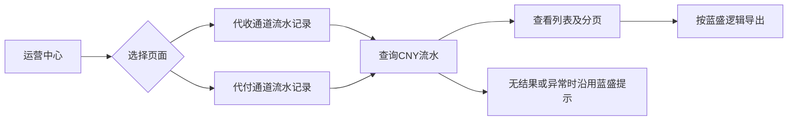
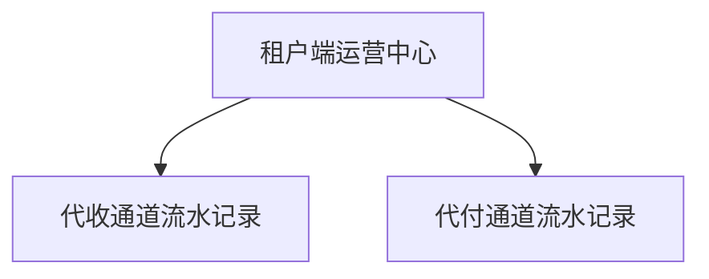

# 蓝盛通道流水迁移至汇盛租户端

本文件与[开发任务清单摘要](%E5%BC%80%E5%8F%91%E4%BB%BB%E5%8A%A1%E6%B8%85%E5%8D%95%E6%91%98%E8%A6%81.md)共同覆盖两个页面，作为同一个需求项目交付。

## §1 需求说明

将蓝盛现有的“代收通道流水记录”“代付通道流水记录”迁移至汇盛支付租户端运营中心。**以蓝盛对应页面及现有代码逻辑为迁移基线，查询、分页、数据口径和导出沿用蓝盛处理方式，不另行设计账务逻辑。**

| 页面 | 蓝盛迁移来源 | 汇盛目标入口 |
|---|---|---|
| 代收通道流水记录 | [蓝盛代收流水](https://j3-web.newopsname.com/record/channel-pay-change) | 租户端 → 运营中心 → 代收通道流水记录 |
| 代付通道流水记录 | [蓝盛代付流水](https://j3-web.newopsname.com/record/channel-payout-change) | 租户端 → 运营中心 → 代付通道流水记录 |

汇盛适配项：接入统一导航与页面样式，数据归属当前租户，两个页面均只展示 CNY，隐藏 USDT、TRX 等其他币种入口。

## §2 背景与目标

- 为租户运营人员提供通道代收、代付金额变动记录的查询与导出入口。
- 直接迁移蓝盛已有能力，保留两张页面各自的字段及处理方式。

## §3 功能清单

| 页面 | 本期建设内容 |
|---|---|
| [NEW] 代收通道流水记录 | 迁移蓝盛代收流水列表、筛选、搜索、重置、分页、导出，仅保留 CNY |
| [NEW] 代付通道流水记录 | 迁移蓝盛代付流水列表、筛选、搜索、重置、分页、导出，仅保留 CNY |

## §4 功能细节规格

### 4.1 代收通道流水记录

| 区域 | 内容 |
|---|---|
| 筛选项顺序 | 平台订单号、商户订单号、类型、变更起始时间至变更结束时间、通道 |
| 操作按钮 | 搜索、重置、导出 |
| 类型选项 | 全部类型、后台调整、代收、结算、下发、活动赠送、其他 |
| 币种 | 仅 CNY |
| 列顺序 | 序号、通道名称、平台订单号、商户订单号、类型、币种、原金额、变动金额、变动后金额、变动时间、备注 |
| 分页 | 默认每页10条，可选10／20／50／100条，提供前后页、页码和跳页 |

- 搜索、重置、日期处理、金额口径、排序和导出沿用蓝盛代收流水代码逻辑。
- 空结果、异常提示及分页边界沿用蓝盛既有处理。

### 4.2 代付通道流水记录

| 区域 | 内容 |
|---|---|
| 筛选项顺序 | 平台订单号、商户订单号、类型、变更起始时间至变更结束时间、通道 |
| 操作按钮 | 搜索、重置、导出 |
| 类型选项 | 全部类型、代付退回、后台调整、代付、结算、订单冲销 |
| 币种 | 仅 CNY |
| 列顺序 | 序号、通道名称、通道商名称、平台订单号、商户号、类型、币种、原金额、变动金额、变动后金额、变动时间、备注 |
| 分页 | 默认每页10条，可选10／20／50／100条，提供前后页、页码和跳页 |

- 搜索、重置、日期处理、金额口径、排序和导出沿用蓝盛代付流水代码逻辑。
- 筛选使用“商户订单号”，列表展示“商户号”，保持蓝盛两者的不同含义。
- 空结果、异常提示及分页边界沿用蓝盛既有处理。

## §5 功能流程图

两张页面使用相同的查询操作流程，各自读取对应方向的流水。

## §6 功能结构图

## §7 页面设计

- 内容区参考蓝盛原页面，使用紧凑筛选栏、表格及分页布局，接入汇盛统一菜单、标题、面包屑与主题样式。
- 两页保留 CNY 页签，其他币种页签不展示。
- 金额两位小数，正变动为绿色、负变动为红色；时间格式为 YYYY/MM/DD HH:mm:ss，长内容支持查看完整值。
- 页面保持流水查询用途，不增加解释面板、行内编辑或资金操作入口。
- 交互参考：[汇盛统一 Demo](https://jeffcity.github.io/huisheng-pay-demo/) → 租户端 → 运营中心 → 对应流水页面。

## §8 异常与边界

| 场景 | 处理要求 |
|---|---|
| 搜索无结果、请求失败、日期异常、跳页越界 | 沿用蓝盛对应页面的校验、提示与处理 |
| 租户或查询方向不同 | 读取汇盛当前租户、当前页面对应方向的流水，不混入其他租户或方向 |
| 非 CNY 币种 | 两页均不提供切换入口，列表及导出按 CNY 范围处理 |
| 浏览或导出记录 | 沿用既有查询权限控制，不改变流水、订单及通道资金数据 |

## §9 验收清单

### 9.1 功能验收

- [ ] 运营中心显示两个独立菜单，名称、页面标题及面包屑对应正确。
- [ ] 代收筛选项、6种类型、11列表头及顺序与本文件一致。
- [ ] 代付筛选项、5种类型、12列表头及顺序与本文件一致；商户订单号查询与商户号展示分别对应正确数据。
- [ ] 两页仅显示 CNY；搜索、重置、分页及导出沿用蓝盛对应代码逻辑，业务口径一致。

### 9.2 展示验收

- [ ] 两页接入汇盛统一外壳；窄容器可横向查看全部表格列，筛选与分页可操作。
- [ ] 金额、正负颜色、时间格式与完整内容查看符合页面规格。

### 9.3 异常与边界验收

- [ ] 无结果、异常请求、无效日期及越界分页按蓝盛现有行为处理。
- [ ] 非 CNY 数据不进入当前列表或导出；其他租户、其他方向的记录不混入结果。

### 9.4 迁移验收

- [ ] 对照蓝盛两个原页面及代码，逐项回归查询、重置、排序、分页和导出；汇盛差异限于目标入口、统一样式、当前租户数据归属和仅 CNY。
- [ ] 使用真实接入数据验收查询与导出，不能以 Demo 的合成数据或本地 CSV 代替正式能力验收。
