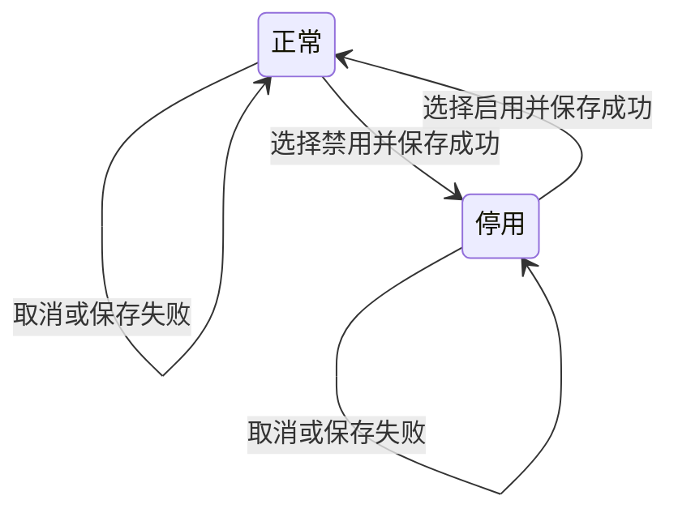
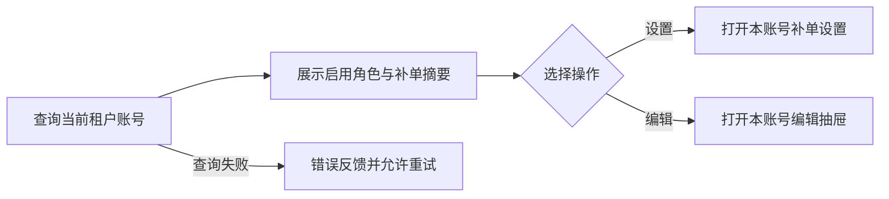
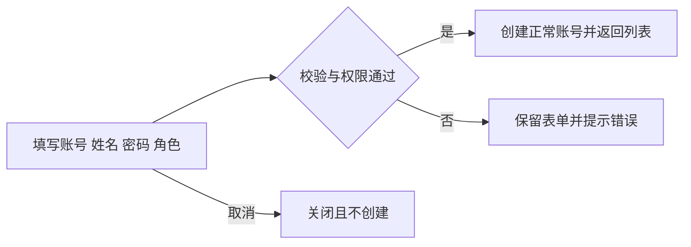
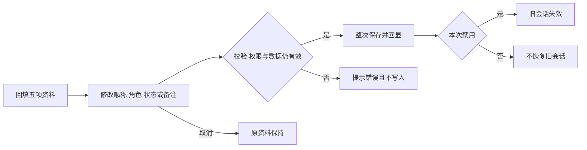
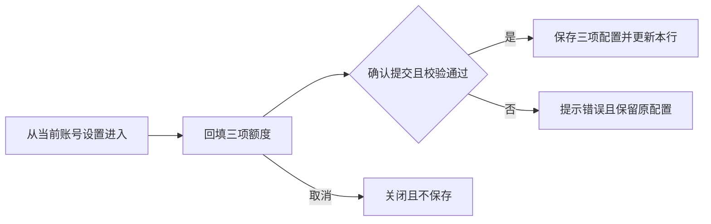
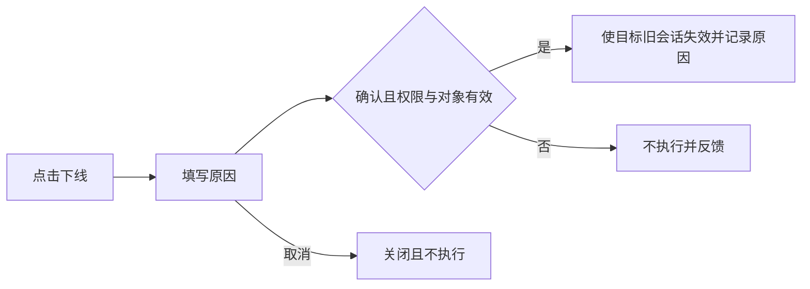
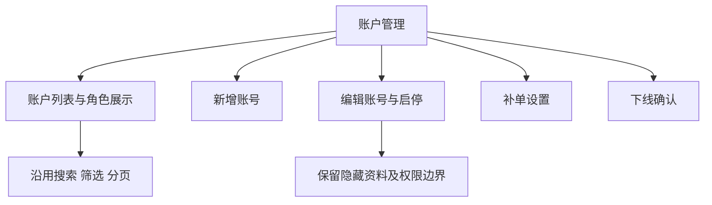

# 租户端账户管理精简与补单展示

## 目录

- [§1 需求说明](#1-需求说明)
- [§2 背景与目标](#2-背景与目标)
- [§3 功能清单](#3-功能清单)
- [§4 功能细节规格](#4-功能细节规格)
- [§5 功能流程图](#5-功能流程图)
- [§6 功能结构图](#6-功能结构图)
- [§7 页面设计](#7-页面设计)
- [§8 异常与边界](#8-异常与边界)
- [§9 验收清单](#9-验收清单)

本文件使用说明：以[现有开发页面](https://saas-tenant-web2.newopsname.com/system/user)为基线，只定义本次确认内容。执行摘要见[开发任务清单摘要](%E5%BC%80%E5%8F%91%E4%BB%BB%E5%8A%A1%E6%B8%85%E5%8D%95%E6%91%98%E8%A6%81.md)；证据及逐项差异见[开发基线对照](%E5%BC%80%E5%8F%91%E5%9F%BA%E7%BA%BF%E5%AF%B9%E7%85%A7.md)；权限、安全和待确认项见[PRD_租户账户管理精简与补单展示_20261021_appendix](PRD_%E7%A7%9F%E6%88%B7%E8%B4%A6%E6%88%B7%E7%AE%A1%E7%90%86%E7%B2%BE%E7%AE%80%E4%B8%8E%E8%A1%A5%E5%8D%95%E5%B1%95%E7%A4%BA_20261021_appendix.md)。本稿没有待补填字段；待确认能力不属于本次必做。

## §1 需求说明

| 项目 | 内容 |
|---|---|
| 产品与归属 | 汇盛支付／租户端／系统管理／账户管理 |
| 改动类型 | [MOD] 在既有账户管理上精简资料、统一状态、优化补单展示和操作确认 |
| 业务对象 | 当前租户的后台登录账号及其角色、状态与补单配置 |
| 交付结果 | 更少的必填资料、清晰的有效角色展示、可直接查看和配置的补单额度 |
| 实际开发基线 | [账户管理](https://saas-tenant-web2.newopsname.com/system/user) |

本次不包含：独立锁定／解锁、重置密码、最近登录时间列、导出账号视图、2FA 新筛选、独立启停行按钮、部门管理改造、角色权限模型改造。

## §2 背景与目标

- 管理员创建账号只需填写登录和授权所需资料。
- 账号编辑聚焦昵称、角色、状态和备注，组织与联系方式不参与本期操作。
- 账户列表直接展示有效角色及补单额度，减少进入弹窗查看的次数。
- 沿用开发环境既有抽屉、多选、状态、搜索分页与重置 2FA 能力。
- 账号展示精简不扩大权限，不清空隐藏资料，不影响其他租户。

## §3 功能清单

以下均为必做；[MOD] 对应[现有账户管理](https://saas-tenant-web2.newopsname.com/system/user)。

| 页面或操作 | 交付内容 |
|---|---|
| 3.1 [MOD] 账户列表 | 移除部门列；增加补单摘要及设置入口；仅展示启用角色 |
| 3.2 [MOD] 新增账号 | 仅账号、姓名、用户密码、角色，四项必填 |
| 3.3 [MOD] 编辑账号 | 只读账号、暱称、角色、状态、选填备注；正常／停用两态 |
| 3.4 [MOD] 补单设置 | 三项额度紧凑横排、顺序与文案对齐、保存回显 |
| 3.5 [MOD] 下线确认 | 操作原因与确认，成功后使目标账号旧会话失效 |

## §4 功能细节规格

### 4.1 账户列表

| 区域 | 规格 |
|---|---|
| 列顺序 | 登录账号、姓名、角色、补单限制、状态、2FA、最近登录 IP、操作 |
| 搜索与分页 | 沿用账号／姓名／IP 搜索、状态及角色筛选、搜索、重置和分页 |
| 角色 | 多个启用角色以标签展示；停用角色不展示；没有启用角色显示“—” |
| 补单限制 | 每日可补单数、每日总金额、单笔金额；金额带 CNY 且显示两位小数；“设置”打开本行账号配置 |
| 操作列 | 沿用编辑、重置 2FA、下线；补单入口统一放在补单限制列，不保留重复入口 |
| 账号状态 | 正常／停用；不展示锁定状态或解锁操作 |

- 角色展示过滤不删除账号和绑定；列表角色名称使用实际租户配置。
- 配置保存后更新对应行；搜索、页码及其他账号内容保持原有处理方式。
- 无权限时遵循现有操作权限；加载或保存失败不展示为成功。
- 全部角色停用时账号仍可被查到，权限贡献继续以启用角色为准。

### 4.2 新增账号

沿用右侧抽屉，填写顺序为登录账号、姓名、用户密码、角色。

| 字段 | 必填 | 输入与规则 |
|---|---|---|
| 登录账号 | 是，红星 | 手动填写；沿用账号格式和租户内唯一性校验；对应开发页原“用户名称” |
| 姓名 | 是，红星 | 对应开发页原“用户昵称”，也是列表姓名及编辑暱称的同一资料 |
| 用户密码 | 是，红星 | 手动填写，沿用现有密码规则与密码显示控制，不生成创建密码结果页 |
| 角色 | 是，红星 | 沿用标签多选，至少选择一个可用角色，不可新绑定停用角色 |

- 不展示或校验部门、手机、邮箱、岗位、性别、状态、备注、账号数据范围、指定商户及开通原因。
- 新账号默认正常；不自动补入预设部门，不因移除输入项而新增额外角色或扩大范围。
- 创建成功返回列表并提示成功；失败保留可继续修改的表单，不创建半成品账号。
- 重复账号、空必填项、无效角色或密码不合规则时阻止创建；密码不进入日志、列表、导出或普通资料回填。

### 4.3 编辑账号

| 顺序 | 字段 | 必填标记与交互 |
|---|---|---|
| 1 | 登录账号 | 红星，只读展示，不能修改 |
| 2 | 暱称 | 红星，可编辑；同列表姓名、新增姓名对应同一资料 |
| 3 | 角色 | 红星，标签式下拉多选，支持勾选、移除单标签和清空；提交时不可为空 |
| 4 | 状态 | 红星，启用／禁用单选，列表分别展示正常／停用 |
| 5 | 备注 | 选填，可保存、回填和清空，不要求填写变更原因 |

- 不展示部门、手机、邮箱、岗位、性别及账号范围；保存仅更新本次可编辑资料，保留其他资料与范围限制。
- 已绑定停用角色可在编辑中显示停用标记，允许保留或移除；不加入新的停用角色绑定。
- 禁用成功后目标账号旧会话失效；重新启用不恢复旧会话，需要重新登录。
- 普通编辑不重置密码或 2FA；无效角色、无权限、受保护账号或过期表单提交失败时，整次不保存。
- 沿用现有管理员保护；不得通过状态或角色编辑使租户失去最后一个可用管理账号。

### 4.4 补单设置

入口为账户列表“补单限制”列中的“设置”，复用当前账号的三项 CNY 补单配置。

| 顺序 | 标签 | 必填与数值 |
|---|---|---|
| 1 | 单次补单金额 | 红星，非负金额，最多两位小数 |
| 2 | 每日补单金额 | 红星，非负金额，最多两位小数 |
| 3 | 每日补单次数 | 红星，非负整数 |

- 标题“补单设置”，标签与输入框横排；默认回填已保存配置，无配置时沿用现有初始化值。
- 按钮“取消／确认提交”；不展示说明横幅、账号摘要、规则段落或只读权限说明。
- 单次金额不得超过每日金额；数值上限沿用现有服务规则。
- 金额单位为 CNY；本次不改变零值含义、计数周期、已用量计算及实际补单授权规则。
- 三项配置一起保存到目标账号，成功后弹窗关闭、列表更新；取消或失败不覆盖配置，不清空已用量。
- 不新增补单业务执行入口；配置上限不代替补单操作权限。

### 4.5 下线确认

- 沿用列表“下线”入口，打开紧凑居中确认弹窗。
- 必填操作原因，空值不执行；按钮“取消／确定”，不显示租户、范围、权限或操作影响说明区块。
- 确认成功后使目标账号已有登录会话失效，账号状态仍为正常或停用原值，不修改密码、角色、2FA 或补单配置。
- 取消、失败、权限变化或目标账号已变化时不执行；成功结果写入现有操作审计，记录原因而不记录认证凭证。
- 此操作不新增账号禁用能力，不同于编辑中的禁用；无权限与受保护账号沿用既有保护。

## §5 功能流程图

### 5.1 账户列表

### 5.2 新增账号

### 5.3 编辑账号

### 5.4 补单设置

### 5.5 下线确认

## §6 功能结构图

## §7 页面设计

| 界面 | 设计要求与参考 |
|---|---|
| 7.1 账户列表 | 八列按4.1顺序，角色标签与补单摘要对应本行；不从 Demo 额外列扩展范围 |
| 7.2 新增账号 | 右侧紧凑抽屉，四项必填；沿用开发环境输入控件与密码控件 |
| 7.3 编辑账号 | 右侧抽屉约560px，控件约32px高，字段间距约16px；标题和操作区固定，正文可滚动；见“证据／目标编辑.png” |
| 7.4 补单设置 | 约480px居中弹窗，三行横排，输入值居中；见“证据／目标补单设置.png” |
| 7.5 下线确认 | 约480px居中弹窗，原因及取消／确定；沿用系统紧凑样式 |

- 容器不足时随可用宽度收缩，正文可滚动，底部操作保持可达；表格按现有方式横向滚动。
- 必填星号使用系统红色；备注不标星。登录账号只读仍保留必填标记。
- 表单仅保留必要字段、状态、错误与结果提示；重置 2FA 的必要后果提示沿用现有实页。
- Demo 中的重置密码、最近登录和导出等附加内容不构成本期交付要求。

## §8 异常与边界

| 条件 | 处理 |
|---|---|
| 账号没有启用角色 | 列表显示“—”，账号行及旧绑定仍保留 |
| 编辑只保留原停用角色 | 允许保留原绑定，不把停用角色作为有效权限；不新增停用绑定 |
| 清空全部角色后提交 | 阻止保存并定位角色字段，原账号不变 |
| 新增隐藏资料为空 | 不因此阻止创建，不自动新增组织或联系资料 |
| 编辑隐藏资料已有值 | 保存后仍保持，不因未展示而覆盖为空 |
| 密码、验证码或角色校验失败 | 不创建或部分更新账号，不进入成功状态 |
| 禁用后重新启用 | 需要重新登录，旧会话不恢复 |
| 管理账号保护命中 | 拒绝变更并提示，不写入其他字段 |
| 下线取消、无权限或对象过期 | 不使其他账号会话失效，不改变账号状态 |
| 补单出现负数、小数次数、超过精度或单次高于每日 | 阻止提交，原配置与已用量保持 |
| 保存失败、重复提交或编辑窗口过期 | 无部分保存或重复业务副作用，提示可重试或重新打开 |
| 备注输入特殊字符 | 作为文本保存和展示，不执行为页面内容 |

## §9 验收清单

### 9.1 功能验收

- [ ] 列表严格按八列顺序展示，部门不展示，补单摘要及入口对应正确账号。
- [ ] 启用／停用角色混合、全部停用及无启用角色三种数据下，标签与账号保留规则均符合4.1。
- [ ] 新增只展示四项且均带红星；缺任一必填项或重复账号不能创建，合法填写可创建正常账号。
- [ ] 编辑只展示五项，前四项红星；登录账号只读，暱称保存后列表姓名同步，备注可清空。
- [ ] 角色多选、标签移除、清空校验及原停用角色保留／移除均可用。
- [ ] 状态仅正常／停用；禁用使旧会话失效，重新启用不恢复旧会话；无锁定／解锁操作。
- [ ] 补单弹窗标题、三项顺序、红星、横排和按钮与4.4一致；保存后对应行回显正确，取消不保存。
- [ ] 下线必须经原因确认，成功只使目标会话失效，不改变其状态或其他资料。
- [ ] 原搜索、筛选、重置和分页可用；重置 2FA 原因、Google 验证码、取消、成功重绑和错误处理通过回归。

### 9.2 非功能验收

- [ ] 无权限、跨租户、受保护账号和过期表单均不能写入；详细口径见附录 A4。
- [ ] 保存失败无部分写入，密码及验证码不出现在普通返回内容、日志、列表和导出中。
- [ ] 窄容器不裁切字段与底部操作，Tab可达全部控件，错误提示关联对应字段。

### 9.3 边界验收

- [ ] §8每种条件均以受控数据验证，结果与处理列一致。
- [ ] 改备注或角色不会清空隐藏组织／联系资料、改变2FA或扩大原数据范围。
- [ ] 保存补单上限不清零已用量，不影响其他账号、其他租户或实际补单权限。

### 9.4 权限与安全专项验收

- [ ] 对启停、角色、补单和下线提交分别验证当前操作权限、当前租户及目标身份，失败不执行。
- [ ] 使用另一已登录终端验证禁用与下线后的旧会话确实失效；仅检查页面标签不算通过。
- [ ] 重置 2FA 必须通过现有真实认证流程；本地演示验证码不作为开发验收依据。
- [ ] 操作审计可定位目标账号、动作、操作人、结果及必要原因；不记录密码或验证码。

下一步建议：按[开发任务清单摘要](%E5%BC%80%E5%8F%91%E4%BB%BB%E5%8A%A1%E6%B8%85%E5%8D%95%E6%91%98%E8%A6%81.md)实施，在测试租户使用受控账号完成字段、权限、会话及补单配置联调。
