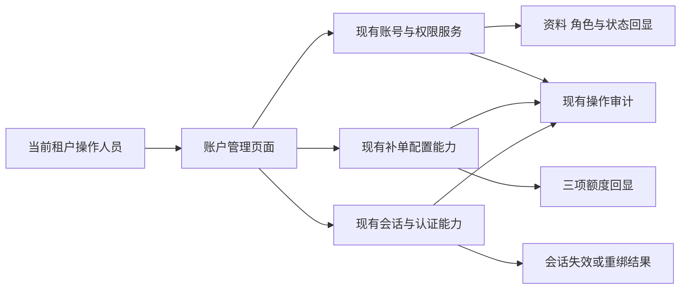
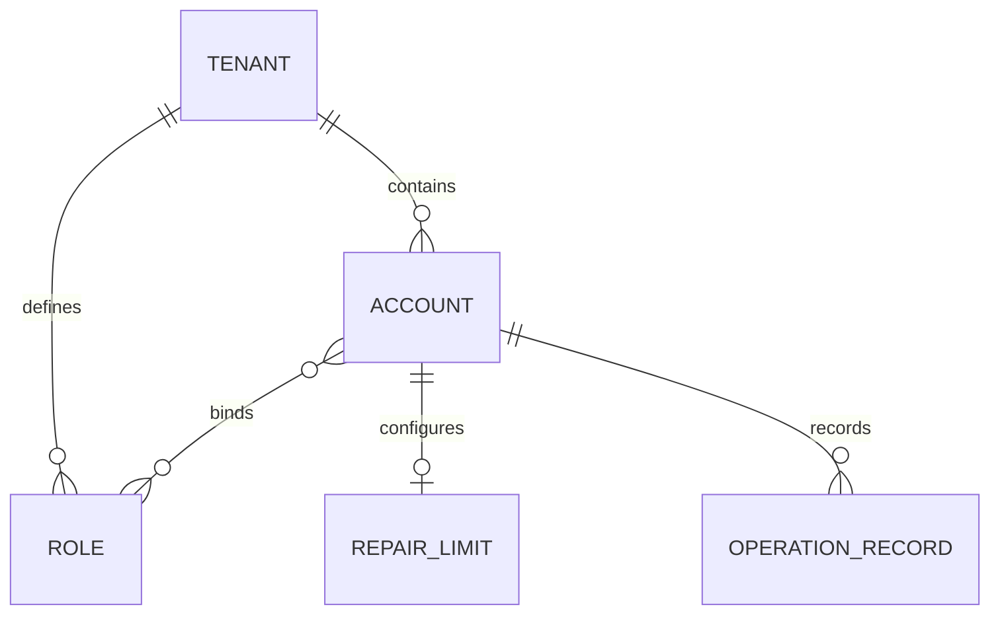

# 账户管理附录

## A2 目标用户与角色

| 用户 | 使用目的 | 权限原则 |
|---|---|---|
| 当前租户具备账号管理权限的人员 | 新增、编辑及启停账号 | 仅在既有权限内管理本租户账号 |
| 具备补单配置权限的人员 | 维护单账号三项补单上限 | 配置权限与实际补单操作权限分别校验 |
| 具备账号安全操作权限的人员 | 下线或重置2FA | 沿用现有认证和受保护账号规则 |
| 无相应权限的人员 | 查看被授权的页面或资料 | 不因入口或字段精简获得新增权限 |

本次不按演示角色名称新增预设角色，也不调整角色管理页面。

## A3 资料流与系统衔接

- 采用现有账号、角色、补单及认证能力，不据本地演示状态判定服务端已生效。
- 登录账号与昵称保持原资料归属；部门、手机等隐藏资料不作为清空指令提交。
- 下线与禁用只作用于当前租户的目标账号，不改变其他租户、其他账号或补单已用量。

## A4 非功能性与安全要求

| 项目 | 可判定要求 |
|---|---|
| 权限与隔离 | 服务端验证当前操作者、租户、目标账号及操作权限；跨租户或无权限时无写入 |
| 原子性 | 同次编辑任一校验失败，昵称、角色、状态和备注均保持原值 |
| 旧会话 | 禁用及下线成功后，旧登录凭证不能继续操作；启用不使旧凭证恢复有效 |
| 敏感资料 | 密码与验证码不进入审计、普通资料回填、导出、缓存或前端持久化 |
| 重复与并发 | 重复提交无重复副作用；目标已改变时拒绝旧窗口覆盖并提示重新打开 |
| 审计 | 使用现有审计能力记录对象、动作、操作者、结果和必要原因；用户文字按纯文本呈现 |
| 失败反馈 | 接口失败不得显示成功；允许修正或重试，不错误显示其他账号资料 |
| 交互可用 | 标题和操作可达、正文可滚动、键盘可操作，错误与字段关联 |

本次没有新性能容量目标，延续现有项目的性能与兼容要求。

## A7 B端专项

### A7.1 操作边界

| 操作 | 有对应权限 | 无对应权限 |
|---|---|---|
| 新增与编辑 | 当前租户内提交；管理员保护仍生效 | 不可执行 |
| 启用／禁用 | 通过编辑表单维护；禁用使旧会话失效 | 不可执行 |
| 补单配置 | 只保存目标账号的三项额度 | 不可执行 |
| 下线 | 原因确认后使目标旧会话失效 | 不可执行 |
| 重置2FA | 沿用原因及当前操作人Google验证 | 不可执行 |

### A7.2 多租户

- 账号、角色选择、补单配置与审计均按当前租户隔离。
- 不增加跨租户管理或批量操作；不改变现有审批链。

### A7.3 业务实体关系

| 业务对象 | 本次涉及内容 |
|---|---|
| 账号 | 登录账号、昵称、状态、备注；其他资料保留 |
| 角色绑定 | 多角色、角色启停与既有绑定保留 |
| 补单限制 | 单次金额、每日金额、每日次数 |
| 操作记录 | 资料变更、额度变更、下线与结果 |

此图表达业务关系，不指定数据库结构或新增存储实体。

## A9 待确认事项

| 能力 | 当前处理 | 后续需明确 |
|---|---|---|
| 重置密码 | 不计入本期 | 是否建设、验证方式、密码交付及有效期 |
| 最近登录时间列 | 不计入本期 | 是否展示、时间来源及格式 |
| 导出账号视图 | 不计入本期 | 是否建设、导出字段、权限和文件规则 |
| Demo额外2FA筛选、独立启停行按钮 | 不计入本期，不由Demo存在推导开发任务 | 如需建设另行明确范围 |

锁定／解锁不再作为独立能力待确认，本期统一正常／停用与启用／禁用。

## A11 相关资源

- [开发任务清单摘要](%E5%BC%80%E5%8F%91%E4%BB%BB%E5%8A%A1%E6%B8%85%E5%8D%95%E6%91%98%E8%A6%81.md)
- [开发基线对照](%E5%BC%80%E5%8F%91%E5%9F%BA%E7%BA%BF%E5%AF%B9%E7%85%A7.md)
- [开发补充说明](%E5%BC%80%E5%8F%91%E8%A1%A5%E5%85%85%E8%AF%B4%E6%98%8E.md)
- [开发环境账户管理](https://saas-tenant-web2.newopsname.com/system/user)
- [本地统一Demo](https://jeffcity.github.io/huisheng-pay-demo/#tenant)
- 本快照证据目录仅包含目标编辑和补单设置截图；开发环境原始截图留在需求编辑源。
