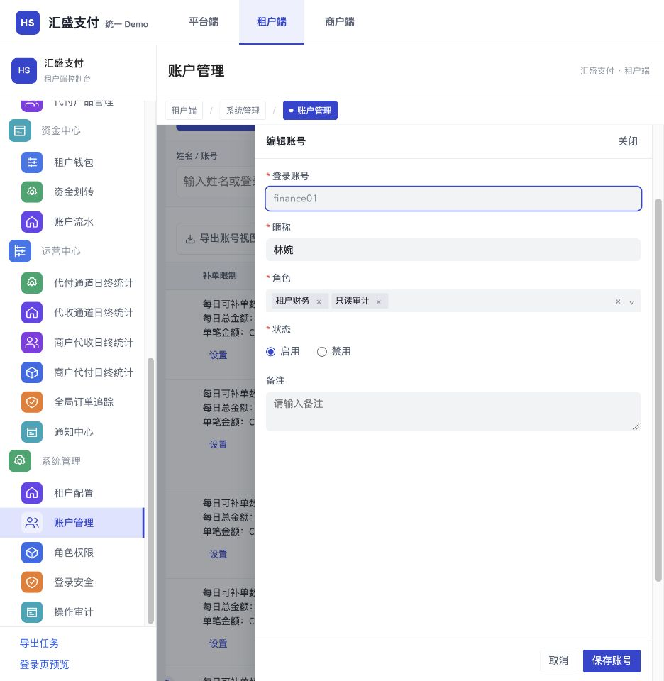
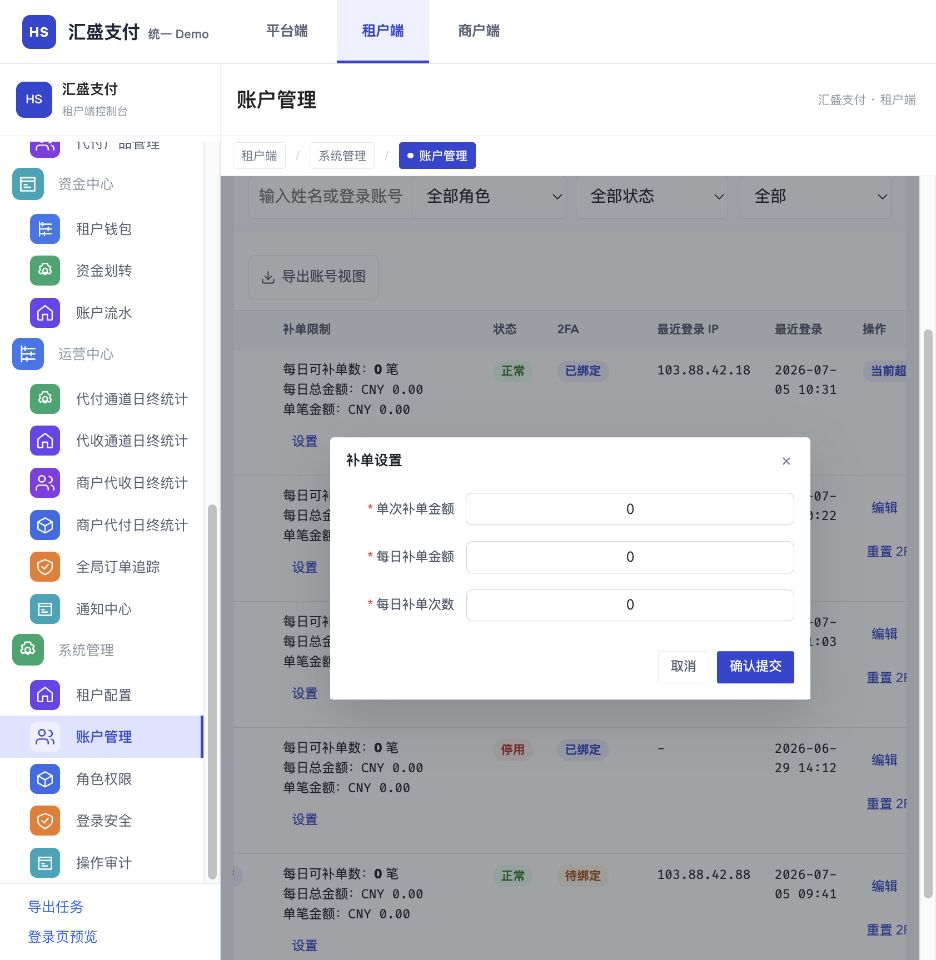
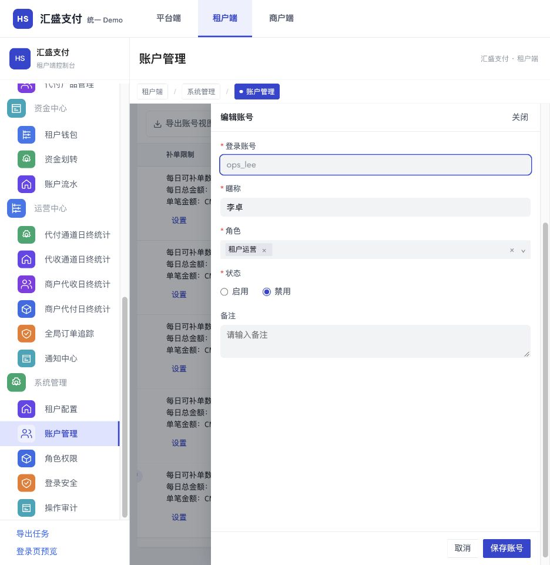

# 租户端账户管理交付资料

以[现有开发账户管理](https://saas-tenant-web2.newopsname.com/system/user)为基线，精简新增及编辑字段、仅展示启用角色、增加列表补单额度摘要，并调整补单设置与下线确认。账号状态统一正常／停用，不单独建设锁定／解锁。

- [开发任务清单摘要](开发任务清单摘要.md)
- [开发基线逐项对照](开发基线对照.md)
- [PRD](PRD_租户账户管理精简与补单展示_20261021.md)
- [PRD附录](PRD_租户账户管理精简与补单展示_20261021_appendix.md)
- [开发补充说明](开发补充说明.md)
- [待确认事项](待确认事项.md)
- [统一Demo在线入口](https://jeffcity.github.io/huisheng-pay-demo/#tenant)：租户端 → 系统管理 → 账户管理。在线内容随main发布，未合并PR不改变线上版本。

本目录为只读交付快照，需求编辑源为同级需求文件夹“2026-10-20-账户管理角色展示简化”。Demo唯一源码为[system.html](../../../surfaces/tenant/public/legacy/sources/system.html)，不在本目录复制HTML。

本期不包含重置密码、最近登录时间、导出账号视图，以及Demo额外的2FA筛选和独立启停行按钮。已有角色多选、启停、2FA认证与补单配置采用沿用或回归，不重复建设。

## 目标截图

截图使用Demo虚构样例。真实开发环境截图不上传本快照；账户认证、会话、权限及补单执行需要服务端联调。
