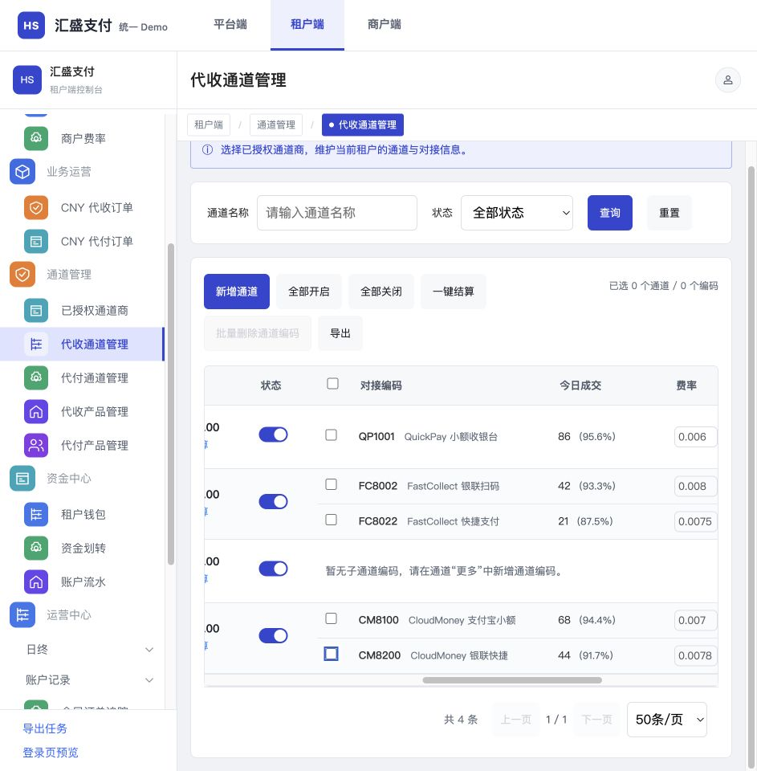
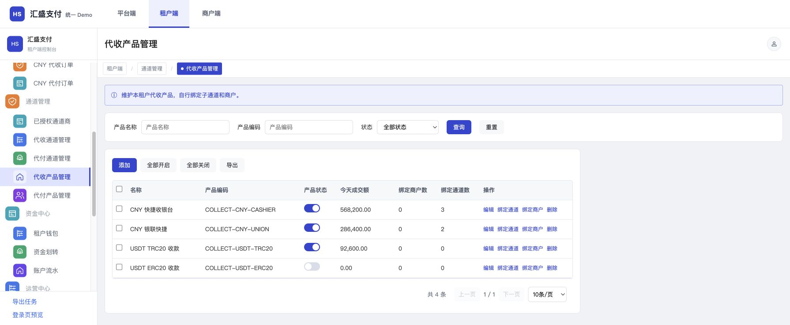

# 验证记录

## 验证范围

提交基于main提交`11fe9bf`，只包含通道与产品页面、子编码模拟统计、对应测试、交付说明与统一生成入口。业务页面源与唯一维护Demo对应文件一致，发布快照不包含本地其他需求的未提交文件。

## 检查结果

- 构建及单文件完整性检查通过；214项测试通过。
- 完整`npm run smoke`通过，覆盖单文件离线及子路径、三端切换卸载、授权工作区、平台月结、商户管理、业务配置、登录、账号补单设置与消息通知。
- 独立复核：成功率及通道回归38项通过；模型除16处子编码模拟成功率字段外，与main一致；成功率不取父通道数据，0%、未知值及复制清除统计符合需求；未发现新增真实资金写入。
- 页签切换使用当前置顶集合清空状态；最终构建及统一入口导航冒烟复测通过。
- 浏览器943×960下，成功率单元格宽145px，内容宽约76—79px；多编码行44px，单编码父通道行79px，同行显示。
- 两张产品表普通行44px，勾选、状态与数量列收紧，操作同行；小屏在表格容器内滚动。

当前成功率为虚构样例。真实接口统计公式、角色权限与生产数据隔离仍需开发环境联调；本地原型检查不替代这些验证。

## 评审截图

