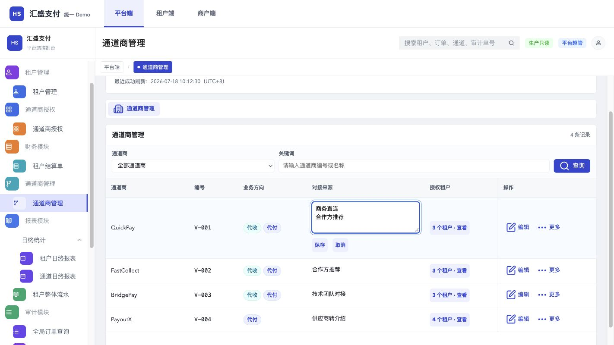
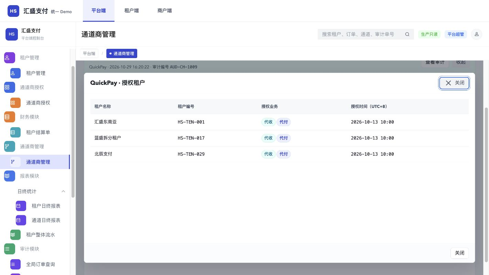

# 通道商来源与授权租户

[统一Demo](https://jeffcity.github.io/huisheng-pay-demo/) → 平台端 → 通道商管理。

本目录为需求资料的交付快照，包含[开发任务清单摘要](开发任务清单摘要.md)、[完整开发任务清单](开发任务清单.md)与[需求说明](需求说明.md)。

对接来源可在表单维护或双击行内编辑；授权租户名单只读，计数和名单按当前有效授权及账号范围展示。

